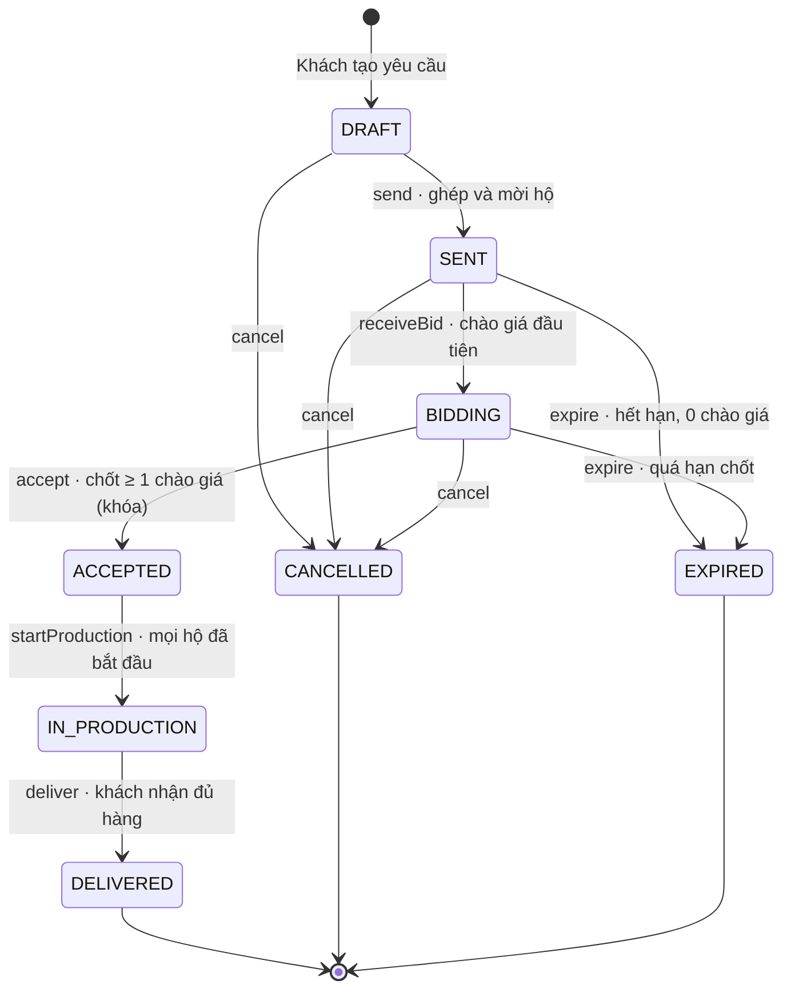
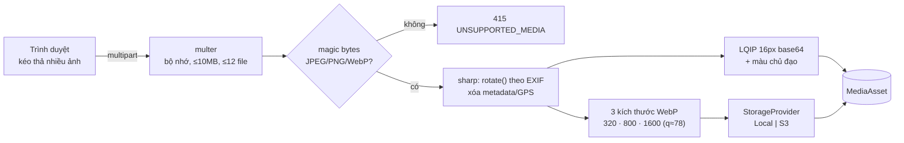

# vCraft: Tài liệu đặc tả yêu cầu sản phẩm (PRD)

| | |
|---|---|
| Sản phẩm | vCraft, nền tảng Triển lãm số và Điều phối đơn cho làng gốm Bát Tràng |
| Học phần | INT3306 Phát triển ứng dụng web, Fall 2026 |
| Phiên bản | 1.0, ngày 02/11/2026 |
| Trạng thái | Đã chốt phạm vi P0. P1 và P2 có thể điều chỉnh theo tiến độ |
| Liên quan | [Mô tả sản phẩm](PRODUCT.md) · [Lộ trình](ROADMAP.md) · [README](../README.md) |

**Mục lục**

1. [Tổng quan](#1-tổng-quan)
2. [Truy vết yêu cầu đề bài](#2-truy-vết-yêu-cầu-đề-bài)
3. [Vai trò và phân quyền](#3-vai-trò-và-phân-quyền)
4. [Yêu cầu chức năng](#4-yêu-cầu-chức-năng)
5. [Đặc tả nghiệp vụ chi tiết](#5-đặc-tả-nghiệp-vụ-chi-tiết)
6. [Yêu cầu phi chức năng](#6-yêu-cầu-phi-chức-năng)
7. [Kiến trúc và lựa chọn công nghệ](#7-kiến-trúc-và-lựa-chọn-công-nghệ)
8. [Mô hình dữ liệu](#8-mô-hình-dữ-liệu)
9. [Thiết kế API](#9-thiết-kế-api)
10. [Định tuyến URL](#10-định-tuyến-url)
11. [Ánh xạ barem chấm điểm](#11-ánh-xạ-barem-chấm-điểm)
12. [Rủi ro và phương án](#12-rủi-ro-và-phương-án)
13. [Tiêu chí nghiệm thu](#13-tiêu-chí-nghiệm-thu)

---

## 1. Tổng quan

### 1.1 Mục đích tài liệu
Tài liệu này là **nguồn sự thật duy nhất** về việc vCraft phải làm gì. Mọi issue trên bảng công việc đều dẫn chiếu về một mã yêu cầu ở đây (ví dụ `QUO-08`). Khi có thay đổi phạm vi, cập nhật tài liệu này trước rồi mới sửa code.

### 1.2 Mục tiêu

| Mã | Mục tiêu | Đo bằng |
|---|---|---|
| G1 | Đáp ứng 100% chức năng đề bài cho 3 vai trò | Bảng truy vết ở mục 2: mọi dòng đều có yêu cầu P0 đạt |
| G2 | Truy xuất nguồn gốc dùng được ngoài đời thật | Quét QR bằng điện thoại thật ra đúng trang truy xuất trong dưới 3 giây |
| G3 | Luồng báo giá đúng và an toàn khi có tranh chấp | Test đồng thời: 2 yêu cầu chốt cùng lúc thì đúng 1 thành công |
| G4 | Giao diện đẹp, có bản sắc, nhanh với nhiều ảnh | Lighthouse Performance ≥ 90 trên máy tính. Tổng ảnh trang danh sách ≤ 1 MB |
| G5 | Đạt trọn 9 tiêu chí barem | Checklist ở [ROADMAP, Phụ lục A](ROADMAP.md) tick đủ |

### 1.3 Không phải mục tiêu
Thanh toán trực tuyến, kết nối vận chuyển, chat thời gian thực, ứng dụng di động riêng, giỏ hàng bán lẻ. Xem [PRODUCT, mục 11](PRODUCT.md).

### 1.4 Thuật ngữ

| Thuật ngữ | Nghĩa |
|---|---|
| Hộ nghề / Xưởng (`Workshop`) | Một hộ gia đình hoặc nghệ nhân làm gốm. Mỗi tài khoản nghệ nhân sở hữu đúng một xưởng |
| Lô (`Batch`) | Một mẻ sản xuất có mã duy nhất, ví dụ `BT26-00042`. Mọi sản phẩm cùng lô dùng chung QR |
| Mốc / Công đoạn (`ProductionStage`) | Một mục trong nhật ký lô: thời điểm, công đoạn, mô tả, ảnh minh chứng |
| Mẫu công đoạn (`StageTemplate`) | Danh sách công đoạn chuẩn của nghề, dùng để gợi ý khi thêm mốc |
| Yêu cầu báo giá (`QuoteRequest`, RFQ) | Nhu cầu mua sỉ của khách, ví dụ `RFQ26-0007` |
| Lời mời (`QuoteInvitation`) | Bản ghi "hộ X được mời chào giá cho RFQ Y" |
| Chào giá (`Bid`) | Đề nghị của một hộ: đơn giá, số lượng nhận làm, số ngày hoàn thành |
| Đơn (`Order`) và Phân bổ (`OrderAllocation`) | Đơn sinh ra khi khách chốt. Mỗi phân bổ là phần việc của một hộ trong đơn |
| Hộ nghề xác thực | Hộ đã được Admin duyệt hồ sơ, có huy hiệu con dấu |

### 1.5 Mức ưu tiên
- **P0, bắt buộc:** đề bài yêu cầu trực tiếp. Thiếu là mất điểm chức năng.
- **P1, nên có:** tăng điểm chức năng, thiết kế, hiệu năng. Chỉ làm sau khi P0 của module đã xong.
- **P2, có thì tốt:** chỉ làm khi dư thời gian. Là phần đầu tiên bị cắt nếu trễ.

---

## 2. Truy vết yêu cầu đề bài

| Mã | Yêu cầu trong đề bài | Đáp ứng bởi |
|---|---|---|
| YC-01 | Nghệ nhân quản lý hồ sơ xưởng: lịch sử gia đình, ảnh xưởng, chứng nhận chất lượng | WS-01 đến WS-04 |
| YC-02 | Nghệ nhân đăng sản phẩm, có giá bán **và** nhật ký sản xuất | PRD-01 đến PRD-03, TRC-01 đến TRC-04 |
| YC-03 | Nghệ nhân nhận và chào giá các yêu cầu báo giá | QUO-03 đến QUO-05, ORD-02 đến ORD-04 |
| YC-04 | Khách xem danh mục sản phẩm theo hộ gia đình hoặc theo phân loại | CAT-01 đến CAT-05 |
| YC-05 | Khách xem bản đồ làng nghề để biết xưởng nào đang mở cửa | MAP-01 đến MAP-05 |
| YC-06 | Khách tạo yêu cầu báo giá. Hệ thống gửi tới các hộ phù hợp để chào giá | QUO-01, QUO-02, mục 5.3 |
| YC-07 | Admin kiểm duyệt và cấp tài khoản hộ, tránh hàng nhái trà trộn | AUTH-02, ADM-01, ADM-02 |
| YC-08 | Admin quản lý tin tức cộng đồng: giá nguyên vật liệu, lịch cúp điện, chính sách | NEWS-01 đến NEWS-04 |
| YC-09 | Lưu vòng đời của lô: một mảng mốc thời gian kèm ảnh minh chứng | TRC-01 đến TRC-04, mục 5.5 |
| YC-10 | Tự sinh QR cho mỗi lô. Quét ra landing page kể chuyện. Cùng lô thì cùng QR | TRC-05 đến TRC-07 |
| YC-11 | Máy trạng thái báo giá: Draft → Sent → Bidding → Accepted → In Production → Delivered | QUO-\*, ORD-\*, mục 5.1 |
| YC-12 | Logic khóa bản ghi và cập nhật trạng thái phức tạp | QUO-08, mục 5.2 |
| YC-13 | BQL phân bổ đơn lớn cho nhiều hộ cùng thực hiện | QUO-07, ORD-01, ORD-05, ADM-06, mục 5.4 |
| YC-14 | Tích hợp API bản đồ. Ghim theo tọa độ. Bấm ghim xem popup | MAP-01 đến MAP-03, mục 5.6 |
| YC-15 | Giao diện đẹp, tập trung vào hình ảnh | [PRODUCT, mục 9 và 10](PRODUCT.md), USA-01 đến USA-03 |
| YC-16 | Upload nhiều ảnh, tối ưu và resize ảnh ở backend | MED-01 đến MED-06, mục 5.7 |

---

## 3. Vai trò và phân quyền

Mỗi tài khoản có đúng một vai trò: `BUYER`, `ARTISAN` hoặc `ADMIN`. Nghệ nhân mới đăng ký có `status = PENDING` cho đến khi được duyệt.

| Chức năng | Khách vãng lai | Khách hàng | Nghệ nhân chờ duyệt | Nghệ nhân đã duyệt | Admin |
|---|:-:|:-:|:-:|:-:|:-:|
| Xem sản phẩm, xưởng, bản đồ, tin tức, trang truy xuất | ✅ | ✅ | ✅ | ✅ | ✅ |
| Tạo và quản lý yêu cầu báo giá | – | ✅ của mình | – | – | Xem tất cả, hủy |
| Sửa hồ sơ xưởng | – | – | ✅ bản nháp | ✅ của mình | ✅ |
| Đăng sản phẩm công khai | – | – | Chỉ lưu nháp | ✅ của mình | Ẩn / hiện |
| Lô sản xuất và nhật ký | – | – | – | ✅ của mình | Chỉ xem |
| Chào giá | – | – | – | ✅ khi được mời | Chỉ xem |
| Cập nhật tiến độ phân bổ | – | – | – | ✅ của mình | Chỉ xem |
| Xác nhận đã nhận hàng | – | ✅ đơn của mình | – | – | – |
| Duyệt hộ nghề, khóa tài khoản | – | – | – | – | ✅ |
| Tin tức, danh mục, mẫu công đoạn | – | – | – | – | ✅ |
| Mời thêm hộ vào yêu cầu báo giá | – | – | – | – | ✅ |

**Quy tắc sở hữu:** nghệ nhân chỉ thao tác được trên bản ghi có `workshopId` trùng xưởng của mình. Khách chỉ thao tác được trên RFQ có `buyerId` của mình. Kiểm tra này nằm ở tầng service, không chỉ ở giao diện (xem SEC-03). **Đấu giá kín:** nghệ nhân không bao giờ thấy chào giá của hộ khác.

---

## 4. Yêu cầu chức năng

### 4.1 AUTH: Xác thực và tài khoản

| Mã | Yêu cầu | Ưu tiên | Tiêu chí chấp nhận |
|---|---|:-:|---|
| AUTH-01 | Đăng ký tài khoản khách hàng | P0 | Email chưa tồn tại (kiểm tra ngay khi rời ô nhập). Mật khẩu ≥ 8 ký tự, có chữ hoa, chữ thường và số. Đăng ký xong tự đăng nhập |
| AUTH-02 | Đăng ký nghệ nhân qua 3 bước: tài khoản → thông tin xưởng và vị trí → minh chứng | P0 | Tạo `User(PENDING)`, `Workshop` nháp và `ArtisanApplication(PENDING)`. Có thể quay lại bước trước mà không mất dữ liệu. Khi chưa duyệt, sản phẩm không hiển thị công khai |
| AUTH-03 | Đăng nhập, đăng xuất. Refresh token xoay vòng | P0 | Access token 15 phút. Refresh token 7 ngày trong cookie `httpOnly`. Đăng xuất thì thu hồi phiên. Tài khoản bị khóa thì không đăng nhập được |
| AUTH-04 | Quên và đặt lại mật khẩu qua email | P1 | Token dùng một lần, hết hạn sau 30 phút. Phản hồi giống nhau dù email có tồn tại hay không, để không lộ thông tin tài khoản |
| AUTH-05 | Khóa tạm sau 5 lần đăng nhập sai trong 15 phút | P1 | Lần thứ 6 nhận `429`, kèm thông báo thời gian mở lại |
| AUTH-06 | Hồ sơ cá nhân, đổi mật khẩu | P1 | Đổi mật khẩu thì thu hồi mọi phiên khác |
| AUTH-07 | Xem các thiết bị đang đăng nhập, đăng xuất tất cả | P2 | Liệt kê phiên theo trình duyệt, IP, thời điểm |

### 4.2 WS: Hồ sơ xưởng

| Mã | Yêu cầu | Ưu tiên | Tiêu chí chấp nhận |
|---|---|:-:|---|
| WS-01 | Sửa hồ sơ xưởng: tên, câu chuyện gia đình (rich text), năm thành lập, số đời truyền nghề, nghệ nhân chính, địa chỉ, tọa độ, điện thoại, giờ mở cửa từng ngày trong tuần, có nhận khách tham quan không, có dịch vụ trải nghiệm không, năng lực sản xuất mỗi tháng, có nhận đơn sỉ không, các danh mục sở trường | P0 | Slug tự sinh từ tên (bỏ dấu), không trùng. Đổi tên thì slug cũ vẫn chuyển hướng được (mục 10.3). Rich text được làm sạch ở server |
| WS-02 | Thư viện ảnh xưởng | P0 | Upload nhiều ảnh, kéo thả để sắp xếp, chọn ảnh bìa, xóa ảnh. Tối đa 30 ảnh |
| WS-03 | Chứng nhận chất lượng: tên, nơi cấp, ngày cấp, ảnh | P0 | Thêm, sửa, xóa. Hiển thị trên trang công khai |
| WS-04 | Trang công khai `/xuong/:slug` | P0 | Ảnh bìa, câu chuyện, thư viện ảnh mở dạng lightbox, chứng nhận, sản phẩm, các lô truy xuất, bản đồ nhỏ, trạng thái mở cửa hiện tại, huy hiệu xác thực |
| WS-05 | Danh sách xưởng `/xuong` | P0 | Lọc theo danh mục, đang mở cửa, có trải nghiệm. Không tải lại trang khi lọc |
| WS-06 | Chọn vị trí xưởng trên bản đồ | P1 | Kéo ghim thì địa chỉ tự điền (reverse geocoding). Gõ địa chỉ thì ghim nhảy tới đó |

### 4.3 PRD: Sản phẩm

| Mã | Yêu cầu | Ưu tiên | Tiêu chí chấp nhận |
|---|---|:-:|---|
| PRD-01 | Thêm, sửa, xóa sản phẩm: tên, danh mục, mô tả, chất liệu, loại men, kích thước, giá (hoặc "Liên hệ"), số lượng, trạng thái Nháp / Công khai / Ẩn | P0 | Giá nhập có định dạng `1.250.000 ₫`, lưu dạng số nguyên. Xóa sản phẩm đã từng nằm trong đơn thì chuyển sang ẩn thay vì xóa thật |
| PRD-02 | Nhiều ảnh cho một sản phẩm | P0 | Tối đa 12 ảnh, sắp xếp được, ảnh đầu tiên là ảnh đại diện, có ô mô tả ảnh (alt) |
| PRD-03 | Gắn sản phẩm vào một lô sản xuất | P0 | Chỉ chọn được lô của chính xưởng mình. Trang sản phẩm hiện "Xem hành trình ra đời" và mã QR của lô |
| PRD-04 | Nhãn sản phẩm độc bản | P1 | Bật "Độc bản" thì số lượng cố định bằng 1, hiện nhãn trên thẻ sản phẩm |
| PRD-05 | Nhân bản sản phẩm | P2 | Sao chép mọi trường trừ slug và ảnh, trạng thái mới là Nháp |

### 4.4 CAT: Danh mục, duyệt và tìm kiếm

| Mã | Yêu cầu | Ưu tiên | Tiêu chí chấp nhận |
|---|---|:-:|---|
| CAT-01 | Xem sản phẩm theo phân loại (cây danh mục 2 cấp, ví dụ Đồ thờ › Bát hương) | P0 | `/danh-muc/:slug` có breadcrumb |
| CAT-02 | Xem sản phẩm theo hộ gia đình | P0 | `/xuong/:slug` có tab Sản phẩm và bộ lọc theo xưởng ở `/san-pham` |
| CAT-03 | Lọc, sắp xếp, phân trang | P0 | Lọc theo danh mục, xưởng, khoảng giá, độc bản, có truy xuất. Sắp xếp theo mới nhất, giá tăng, giá giảm. **Không tải lại trang**. Bộ lọc đồng bộ lên URL, dán link sang tab khác vẫn ra đúng kết quả |
| CAT-04 | Tìm kiếm không dấu và gợi ý tức thì | P1 | Gõ "binh hut loc" ra "Bình hút lộc". Gợi ý xuất hiện sau 300 ms ngừng gõ, gồm cả sản phẩm và xưởng, điều hướng được bằng phím |
| CAT-05 | Trang chi tiết sản phẩm | P0 | Thư viện ảnh có phóng to, thông tin xưởng, khối "Hành trình lô", sản phẩm liên quan, nút "Yêu cầu báo giá sỉ" mở biểu mẫu RFQ đã điền sẵn danh mục |
| CAT-06 | Danh sách yêu thích | P2 | Lưu theo tài khoản |

### 4.5 MAP: Bản đồ làng nghề

| Mã | Yêu cầu | Ưu tiên | Tiêu chí chấp nhận |
|---|---|:-:|---|
| MAP-01 | Bản đồ Leaflet với nền OpenStreetMap. Mỗi xưởng đã duyệt là một ghim đặt theo `lat, lng` | P0 | Mở mặc định ở trung tâm làng, mức zoom 15. Có dòng ghi công OSM |
| MAP-02 | Màu ghim theo trạng thái | P0 | 🟢 Men ngọc: đang mở cửa đón khách. ⚪ Tro: đang đóng. 🔵 Viền lam: không nhận khách tham quan. Trạng thái tính ở server (mục 5.6) |
| MAP-03 | Bấm ghim mở popup | P0 | Popup gồm ảnh nhỏ, tên, huy hiệu, trạng thái và giờ mở cửa hôm nay, có trải nghiệm không, nút "Xem xưởng", nút "Chỉ đường" (mở Google Maps) |
| MAP-04 | Bộ lọc và danh sách đồng bộ với bản đồ | P1 | Lọc theo đang mở, có trải nghiệm, danh mục. Bấm một mục trong danh sách thì bản đồ bay tới ghim tương ứng và mở popup |
| MAP-05 | Gom cụm ghim, nút "Vị trí của tôi" | P1 | Thu nhỏ bản đồ thì ghim gộp thành cụm có số đếm |

### 4.6 TRC: Nhật ký sản xuất và truy xuất nguồn gốc

| Mã | Yêu cầu | Ưu tiên | Tiêu chí chấp nhận |
|---|---|:-:|---|
| TRC-01 | Tạo lô: tên, danh mục, số lượng dự kiến, ngày bắt đầu | P0 | Mã lô tự sinh dạng `BT{yy}-{5 chữ số}`, duy nhất, an toàn khi nhiều người tạo cùng lúc |
| TRC-02 | Thêm mốc công đoạn | P0 | Chọn công đoạn từ mẫu của nghề (hệ thống gợi ý công đoạn tiếp theo) hoặc tự đặt tên. Có thời điểm, mô tả, **ít nhất 1 ảnh minh chứng** (tối đa 6) |
| TRC-03 | Kiểm tra thời gian của mốc | P0 | Thời điểm không ở tương lai, không sớm hơn ngày bắt đầu lô. Các mốc hiển thị theo thứ tự thời gian |
| TRC-04 | Hoàn tất lô thì khóa nhật ký | P0 | Điều kiện hoàn tất: có ít nhất 3 mốc, trong đó có mốc "Nung" và "Thành phẩm". Sau khi khóa, không sửa hay xóa được mốc cũ (`409 BATCH_LOCKED`). Chỉ thêm được "ghi chú bổ sung", có đánh dấu thời gian riêng |
| TRC-05 | Sinh QR cho mỗi lô ở backend | P0 | Nội dung QR là `{APP_URL}/q/{mã-lô}`. Tải về được bản PNG (512 hoặc 1024 px) và SVG. Mức sửa lỗi H để chèn được logo vào giữa |
| TRC-06 | Trang truy xuất công khai `/truy-xuat/:maLo` | P0 | Bố cục ở mục 5.5. Ưu tiên điện thoại. Có thẻ meta Open Graph để chia sẻ đẹp |
| TRC-07 | Mọi sản phẩm cùng lô dùng chung QR của lô | P0 | Trang sản phẩm hiển thị đúng QR của lô mà sản phẩm được gắn vào |
| TRC-08 | In tem QR | P1 | Trang in khổ A4, lưới tem 40×50 mm, mỗi tem có QR, mã lô, tên xưởng và con dấu |
| TRC-09 | Đếm lượt quét | P1 | Mỗi lần mở `/q/:ma` thì `scanCount` tăng 1. Nghệ nhân xem được thống kê |
| TRC-10 | Lô đang làm cũng có trang truy xuất | P1 | Hiện nhãn "Đang thực hiện, cập nhật lần cuối …" |
| TRC-11 | Chuỗi băm toàn vẹn nhật ký | P2 | Mỗi mốc lưu `hash = SHA256(hash mốc trước + nội dung)`. Trang truy xuất hiện "Nhật ký toàn vẹn ✓" nếu chuỗi khớp |

### 4.7 QUO: Yêu cầu báo giá và chào giá

| Mã | Yêu cầu | Ưu tiên | Tiêu chí chấp nhận |
|---|---|:-:|---|
| QUO-01 | Khách tạo RFQ qua 3 bước. (1) Nhu cầu: tiêu đề, danh mục, mô tả, số lượng, đơn vị. (2) Yêu cầu riêng: file logo, ảnh mẫu, ngân sách dự kiến (tùy chọn). (3) Thời hạn: hạn nhận báo giá, ngày cần hàng, địa chỉ giao | P0 | Tự lưu nháp. Hạn nhận báo giá ≥ hiện tại + 24 giờ. Ngày cần hàng phải sau hạn nhận báo giá. Số lượng ≥ 50 |
| QUO-02 | Gửi RFQ thì hệ thống ghép hộ phù hợp, tạo lời mời và gửi thông báo | P0 | Thuật toán ghép ở mục 5.3. Khách thấy "Đã mời N xưởng phù hợp" |
| QUO-03 | Nghệ nhân có hộp "Cơ hội báo giá" | P0 | Lọc theo: mới, đã chào giá, đã chốt, đã đóng. Hiển thị hạn còn lại và lý do được mời |
| QUO-04 | Nghệ nhân chào giá: đơn giá, số lượng nhận làm (có thể ít hơn tổng), số ngày hoàn thành, hiệu lực báo giá, ghi chú, ảnh mẫu | P0 | Thành tiền tự tính. Ngày hoàn thành dự kiến được hiển thị và cảnh báo nếu trễ so với ngày cần hàng. Mỗi xưởng chỉ có **một** chào giá cho mỗi RFQ |
| QUO-05 | Sửa hoặc rút chào giá | P0 | Chỉ được khi RFQ ở `SENT` hoặc `BIDDING` và chưa quá hạn nhận báo giá. Mỗi lần sửa thì `version` tăng 1 và lịch sử sửa được lưu lại |
| QUO-06 | Khách so sánh các chào giá | P0 | Bảng có đơn giá, số lượng, thành tiền, ngày hoàn thành dự kiến, đánh giá xưởng. Sắp xếp được theo từng cột |
| QUO-07 | Khách chốt một hoặc nhiều chào giá, chia số lượng | P0 | Tổng số lượng chọn phải **bằng** số lượng yêu cầu. Mỗi phần ≤ số lượng hộ đó nhận làm. Có nút "Gợi ý phân bổ" điền sẵn lựa chọn (mục 5.4). Có hộp thoại xác nhận trước khi chốt |
| QUO-08 | Khóa bản ghi khi chốt | P0 | Thực hiện trong transaction, khóa lạc quan theo `version` (mục 5.2). Nếu dữ liệu đã đổi thì trả `409`. Các chào giá không được chọn tự chuyển `REJECTED` |
| QUO-09 | Hủy RFQ trước khi chốt | P0 | Lý do bắt buộc. Thông báo tới các hộ đã được mời |
| QUO-10 | Hết hạn tự động | P1 | Tác vụ định kỳ: quá hạn nhận báo giá mà không có chào giá nào thì `EXPIRED`. Có chào giá nhưng khách không chốt trong 7 ngày sau hạn thì cũng `EXPIRED`. Nhắc khách 24 giờ trước hạn |
| QUO-11 | Dòng thời gian trạng thái | P0 | Hiển thị cho khách, hộ nghề và admin: ai chuyển, lúc nào, từ trạng thái nào sang trạng thái nào |
| QUO-12 | Hỏi đáp công khai trong RFQ | P2 | Hộ nghề hỏi, khách trả lời, mọi hộ được mời đều thấy |

### 4.8 ORD: Đơn hàng và điều phối sản xuất

| Mã | Yêu cầu | Ưu tiên | Tiêu chí chấp nhận |
|---|---|:-:|---|
| ORD-01 | Chốt RFQ thì tạo đơn và các phân bổ theo hộ | P0 | Mã đơn `ORD{yy}-{4 chữ số}`. Mỗi phân bổ lưu số lượng, đơn giá, hạn giao |
| ORD-02 | Hộ bấm "Bắt đầu sản xuất" | P0 | Khi mọi phân bổ đã bắt đầu thì RFQ tự chuyển `IN_PRODUCTION` |
| ORD-03 | Hộ cập nhật tiến độ và gắn lô sản xuất | P1 | Tiến độ tính theo %. Gắn lô thì khách xem được nhật ký sản xuất của phần đơn đó |
| ORD-04 | Giao và nhận hàng | P0 | Hộ đánh dấu "Đã giao". Khách xác nhận "Đã nhận" cho từng phân bổ. Khi tất cả đã nhận thì RFQ tự chuyển `DELIVERED` |
| ORD-05 | Bảng điều phối cho BQL | P1 | Liệt kê mọi RFQ và trạng thái, số hộ được mời, số chào giá, tiến độ từng phân bổ. Phân bổ sắp trễ hạn có cảnh báo vàng rơm |
| ORD-06 | Khách đánh giá hộ sau khi nhận hàng | P2 | 1 đến 5 sao kèm nhận xét. Điểm này được dùng trong thuật toán ghép hộ |

### 4.9 ADM: Quản trị

| Mã | Yêu cầu | Ưu tiên | Tiêu chí chấp nhận |
|---|---|:-:|---|
| ADM-01 | Hàng đợi duyệt hồ sơ hộ nghề | P0 | Xem minh chứng (ảnh riêng tư, chỉ admin xem được). Số CCCD được che bớt, ví dụ `0012****5678`. Duyệt hoặc Từ chối, từ chối thì bắt buộc nhập lý do. Người đăng ký nhận thông báo, bị từ chối thì sửa và gửi lại được |
| ADM-02 | Tạm khóa và mở khóa tài khoản | P0 | Khóa thì mọi phiên bị thu hồi, sản phẩm và xưởng bị ẩn khỏi trang công khai. Lý do được ghi vào nhật ký thao tác |
| ADM-03 | Quản lý danh mục và mẫu công đoạn | P1 | Thêm, sửa, sắp xếp |
| ADM-04 | Bảng thống kê | P1 | Số hộ theo trạng thái, số sản phẩm theo danh mục, RFQ theo trạng thái, tổng giá trị đơn, lượt quét QR 30 ngày (biểu đồ) |
| ADM-05 | Nhật ký thao tác quản trị | P1 | Ghi lại ai làm gì, lúc nào, trên bản ghi nào. Lọc được |
| ADM-06 | Mời thêm hoặc bớt hộ khỏi một RFQ | P1 | Chỉ khi RFQ ở `SENT` hoặc `BIDDING`. Lời mời được đánh dấu `invitedBy = ADMIN` |

### 4.10 NEWS: Tin tức cộng đồng

| Mã | Yêu cầu | Ưu tiên | Tiêu chí chấp nhận |
|---|---|:-:|---|
| NEWS-01 | Thêm, sửa, xóa tin: tiêu đề, slug, chuyên mục (Giá nguyên vật liệu / Lịch cúp điện / Chính sách hỗ trợ / Sự kiện), ảnh bìa, tóm tắt, nội dung rich text, trạng thái Nháp / Đã đăng / Hẹn giờ, ghim | P0 | Nội dung được làm sạch ở server. Tin hẹn giờ tự hiện khi tới giờ |
| NEWS-02 | Trang `/tin-tuc` và trang chi tiết tin | P0 | Lọc theo chuyên mục, phân trang không tải lại trang |
| NEWS-03 | Tin ghim hiện thành banner | P1 | Banner hiện trên trang chủ và bảng điều khiển của nghệ nhân. Đóng được, nhưng tin ghim mới thì banner hiện lại |
| NEWS-04 | Tin cúp điện có trường riêng | P2 | Thời gian bắt đầu, kết thúc, khu vực (thôn). Hiện nhãn "Sắp diễn ra" hoặc "Đang diễn ra" |
| NEWS-05 | Bảng giá nguyên vật liệu có cấu trúc và biểu đồ | P2 | Đất, men, gas: giá theo từng ngày, có biểu đồ đường |

### 4.11 NTF: Thông báo

| Mã | Yêu cầu | Ưu tiên | Tiêu chí chấp nhận |
|---|---|:-:|---|
| NTF-01 | Chuông thông báo trong ứng dụng | P0 | Đếm số chưa đọc. Bấm vào thì tới đúng trang liên quan. Đánh dấu đã đọc từng cái hoặc tất cả. Tự cập nhật **không tải lại trang** (hỏi lại server mỗi 30 giây) |
| NTF-02 | Thông báo theo thời gian thực bằng Server-Sent Events | P1 | Thay cho việc hỏi lại server định kỳ. Mất kết nối thì quay về hỏi định kỳ |
| NTF-03 | Email cho sự kiện quan trọng | P2 | Được mời chào giá, chào giá được chốt, hồ sơ được duyệt |

Các sự kiện sinh thông báo: `APPLICATION_APPROVED`, `APPLICATION_REJECTED`, `QUOTE_INVITED`, `BID_RECEIVED`, `BID_REVISED`, `QUOTE_CLOSING_SOON`, `BID_ACCEPTED`, `BID_REJECTED`, `QUOTE_CANCELLED`, `ALLOCATION_STARTED`, `ALLOCATION_SHIPPED`, `ORDER_DELIVERED`, `NEWS_PINNED`.

### 4.12 MED: Đa phương tiện

| Mã | Yêu cầu | Ưu tiên | Tiêu chí chấp nhận |
|---|---|:-:|---|
| MED-01 | Upload nhiều ảnh bằng kéo thả | P0 | Xem trước, thanh tiến trình cho từng ảnh, hủy được, báo lỗi cho từng ảnh riêng |
| MED-02 | Backend kiểm tra file | P0 | Kiểm tra định dạng thật bằng magic bytes (JPEG, PNG, WebP). Tối đa 10 MB mỗi ảnh, 12 ảnh mỗi lần. Sai thì trả `415` hoặc `413` |
| MED-03 | Resize và chuyển định dạng ở backend | P0 | Sinh 3 kích thước WebP: 320, 800, 1600 px chiều ngang. Tự xoay theo EXIF. Xóa toàn bộ metadata, kể cả GPS |
| MED-04 | Ảnh mờ giữ chỗ và tải ảnh có chọn lọc | P0 | Ảnh mờ (LQIP) dạng base64 khoảng 300 byte. Frontend dùng `srcset`, `sizes`, `loading="lazy"` và đặt sẵn `aspect-ratio` |
| MED-05 | Cache dài hạn | P1 | Tên file chứa mã băm nội dung. Header `Cache-Control: public, max-age=31536000, immutable` |
| MED-06 | Lớp lưu trữ trừu tượng | P1 | Interface `StorageProvider` có 2 cài đặt: `LocalStorage` và `S3Storage`, chọn bằng biến `STORAGE_DRIVER` |
| MED-07 | Nén ảnh ở trình duyệt trước khi upload | P2 | Ảnh lớn hơn 3 MB được nén xuống chiều dài tối đa 2400 px trước khi gửi |

---

## 5. Đặc tả nghiệp vụ chi tiết

### 5.1 Máy trạng thái báo giá



| # | Từ | Sự kiện (API) | Sang | Ai thực hiện | Điều kiện | Tác động kèm |
|---|---|---|---|---|---|---|
| T1 | `DRAFT` | `send` qua `POST /quotes/:code/send` | `SENT` | Khách sở hữu RFQ | Đủ trường bắt buộc. Hạn nhận báo giá ≥ hiện tại + 24 giờ | Chạy thuật toán ghép hộ, tạo `QuoteInvitation`, thông báo `QUOTE_INVITED` |
| T2 | `SENT` | `receiveBid` qua `POST /quotes/:code/bids` | `BIDDING` | Hộ được mời (hệ thống tự chuyển) | Chưa quá hạn nhận báo giá | Thông báo `BID_RECEIVED` cho khách |
| T3 | `BIDDING` | `accept` qua `POST /quotes/:code/accept` | `ACCEPTED` | Khách sở hữu RFQ | `version` của RFQ khớp. Mỗi chào giá ở `SUBMITTED`, `version` khớp, còn hiệu lực. Tổng số lượng chọn bằng số lượng yêu cầu | Tạo `Order` và các `OrderAllocation`. Chào giá được chọn chuyển `ACCEPTED`, còn lại chuyển `REJECTED`. Thông báo cho mọi hộ đã chào giá |
| T4 | `ACCEPTED` | `startProduction` (khi phân bổ cuối cùng được bắt đầu) | `IN_PRODUCTION` | Hệ thống | Không còn phân bổ nào ở `PENDING_START` | Thông báo cho khách |
| T5 | `IN_PRODUCTION` | `deliver` (khi phân bổ cuối cùng được xác nhận nhận) | `DELIVERED` | Hệ thống | Mọi phân bổ ở `DELIVERED` | Mở chức năng đánh giá |
| T6 | `DRAFT`, `SENT`, `BIDDING` | `cancel` qua `POST /quotes/:code/cancel` | `CANCELLED` | Khách hoặc Admin | Có lý do | Mọi chào giá chuyển `REJECTED`. Thông báo cho các hộ |
| T7 | `SENT`, `BIDDING` | `expire` (tác vụ định kỳ) | `EXPIRED` | Hệ thống | `SENT`: quá hạn và không có chào giá nào. `BIDDING`: quá hạn nhận báo giá + 7 ngày mà chưa chốt | Thông báo cho các bên |

Mọi cặp (trạng thái, sự kiện) không có trong bảng sẽ bị từ chối với `400 INVALID_TRANSITION`. Khách **được phép chốt sớm** trước hạn nhận báo giá. Sau hạn, hộ nghề không thể gửi mới hay sửa chào giá nữa.

**Trạng thái phụ:**
- `Bid`: `SUBMITTED` → `WITHDRAWN` | `ACCEPTED` | `REJECTED`. Sửa giá không đổi trạng thái, chỉ tăng `version` và ghi một `BidRevision`.
- `OrderAllocation`: `PENDING_START` → `IN_PRODUCTION` → `SHIPPED` → `DELIVERED`.
- `Batch`: `IN_PROGRESS` → `COMPLETED` (bị khóa).
- **Trạng thái tổng của đơn chính là trạng thái của RFQ.** Đây là nguồn sự thật duy nhất. Bảng `Order` không lưu trạng thái riêng để tránh hai nơi lệch nhau.

**Cài đặt:** mọi chuyển trạng thái đi qua đúng một hàm.

```ts
// apps/api/src/core/state-machine/quote.machine.ts
export const QUOTE_TRANSITIONS = {
  DRAFT:         { send: 'SENT', cancel: 'CANCELLED' },
  SENT:          { receiveBid: 'BIDDING', cancel: 'CANCELLED', expire: 'EXPIRED' },
  BIDDING:       { accept: 'ACCEPTED', cancel: 'CANCELLED', expire: 'EXPIRED' },
  ACCEPTED:      { startProduction: 'IN_PRODUCTION' },
  IN_PRODUCTION: { deliver: 'DELIVERED' },
  DELIVERED: {}, CANCELLED: {}, EXPIRED: {},
} as const satisfies Record<QuoteStatus, Partial<Record<QuoteEvent, QuoteStatus>>>;

/**
 * Chuyển trạng thái RFQ có điều kiện (khóa lạc quan).
 * Phải được gọi bên trong prisma.$transaction. Service phát sự kiện miền SAU khi commit.
 * @throws InvalidTransitionError nếu sự kiện không hợp lệ với trạng thái hiện tại
 * @throws ConflictError nếu bản ghi đã bị người khác thay đổi
 */
export async function transition(tx: Tx, quote: QuoteRef, event: QuoteEvent, actor: Actor) {
  const to = QUOTE_TRANSITIONS[quote.status][event];
  if (!to) throw new InvalidTransitionError(quote.status, event);

  const { count } = await tx.quoteRequest.updateMany({
    where: { id: quote.id, status: quote.status, version: quote.version },
    data:  { status: to, version: { increment: 1 } },
  });
  if (count === 0) throw new ConflictError('QUOTE_STATE_CONFLICT');

  await tx.quoteStatusHistory.create({
    data: { quoteId: quote.id, fromStatus: quote.status, toStatus: to, actorId: actor.id },
  });
  return to;
}
```

### 5.2 Cơ chế khóa bản ghi và xử lý tranh chấp

**Lựa chọn chính: khóa lạc quan (optimistic locking) bằng cột `version`.**
- Tranh chấp trong thực tế hiếm, nên không cần giữ khóa lâu.
- Dùng được trên mọi CSDL qua Prisma (`updateMany` có điều kiện), không cần câu SQL riêng như `SELECT … FOR UPDATE`. Đây cũng là điểm cộng cho tiêu chí 9 của barem.
- Kết hợp ràng buộc `UNIQUE` ở CSDL cho những trường hợp chống trùng.

| # | Tình huống tranh chấp | Nếu không xử lý | Cơ chế | Kết quả người dùng thấy |
|---|---|---|---|---|
| L1 | Khách bấm "Chốt" ở 2 tab, hoặc bấm đúp | Sinh 2 đơn trùng | Cập nhật có điều kiện `status = BIDDING AND version = v`. `count = 0` thì rollback toàn bộ transaction | Tab sau nhận `409 QUOTE_STATE_CONFLICT`. Giao diện tải lại trạng thái mới và báo "Yêu cầu này đã được chốt" |
| L2 | Nghệ nhân sửa giá đúng lúc khách đang xem và bấm chốt | Chốt theo giá cũ, dẫn tới tranh chấp | Payload chốt gửi kèm `bidVersion` mà khách đã thấy. Lệch thì `409` | "Xưởng Ông Tư vừa cập nhật báo giá (12.000đ → 13.500đ). Vui lòng xem lại." Bảng so sánh tự làm mới |
| L3 | Nghệ nhân sửa hoặc rút chào giá sau khi khách đã chốt | Đơn đã chốt bị thay đổi | Cập nhật chào giá chỉ thành công khi RFQ đang ở `SENT` hoặc `BIDDING` và chào giá đang ở `SUBMITTED`. Điều kiện kiểm tra trong cùng transaction | `409 QUOTE_LOCKED`: "Yêu cầu đã được chốt, không thể sửa chào giá" |
| L4 | Hai hộ gửi chào giá đầu tiên cùng lúc, cả hai cùng kích hoạt `SENT → BIDDING` | Một hộ bị lỗi oan | Chuyển trạng thái này là **idempotent**: nếu RFQ đã ở `BIDDING` thì bỏ qua bước chuyển | Cả hai chào giá đều được ghi nhận |
| L5 | Tác vụ hết hạn chạy đúng lúc khách bấm chốt | RFQ vừa `ACCEPTED` vừa `EXPIRED` | Cả hai đều cập nhật có điều kiện `status` và `version`, nên chỉ một bên thắng | Bên thua: khách nhận `409`, hoặc tác vụ định kỳ bỏ qua bản ghi đó |
| L6 | Mạng chập chờn, nghệ nhân gửi chào giá 2 lần | 2 chào giá trùng | Ràng buộc `UNIQUE(quoteId, workshopId)` trên bảng `Bid` | Lần thứ 2 nhận `409`. Giao diện chuyển sang chế độ sửa chào giá |
| L7 | Sửa mốc nhật ký của lô đã hoàn tất, nhằm làm giả lịch sử | Mất giá trị truy xuất | `Batch.lockedAt` khác null thì API từ chối sửa hoặc xóa mốc | `409 BATCH_LOCKED`. Chỉ được thêm ghi chú bổ sung |
| L8 | Hai lô được tạo cùng lúc | Trùng mã lô | Bảng `Counter`: `update … value = value + 1` là thao tác nguyên tử trên mọi CSDL, cộng thêm `UNIQUE(code)` | Mã lô luôn duy nhất và tăng dần |

**Kiểm thử bắt buộc:** gửi 2 yêu cầu chốt song song (`Promise.all`). Kỳ vọng đúng 1 yêu cầu `200`, 1 yêu cầu `409`, chỉ có 1 `Order` được tạo và có đúng 1 dòng lịch sử `BIDDING → ACCEPTED`.

### 5.3 Thuật toán ghép hộ phù hợp

**Bước 1: Lọc cứng.** Chỉ giữ các xưởng có `status = APPROVED`, chủ xưởng `ACTIVE`, `acceptsWholesale = true`, và danh mục sở trường chứa danh mục của RFQ.

**Bước 2: Chấm điểm từ 0 đến 100.**

| Thành phần | Trọng số | Cách tính |
|---|:-:|---|
| Năng lực | 40 | `min(1, capacityPerMonth × số tháng đến ngày cần hàng / quantity)` |
| Uy tín | 30 | `ratingAvg / 5`. Chưa có đánh giá thì lấy 0,6 |
| Đúng hạn | 20 | Tỷ lệ phân bổ đã giao đúng hạn. Chưa có lịch sử thì lấy 0,8 |
| Phản hồi | 10 | Tỷ lệ lời mời trước đây mà xưởng đã chào giá |

**Bước 3: Mời 10 xưởng điểm cao nhất** (hoặc tất cả nếu ít hơn 10). Lưu `matchScore` và `matchReasons` để hiển thị cho hộ nghề, ví dụ: *"Bạn được mời vì: sở trường Cốc chén, năng lực 3.000 sản phẩm/tháng."*

**Bước 4:** Admin có thể mời thêm hoặc bớt xưởng thủ công (ADM-06).

Một xưởng không đủ năng lực làm cả đơn vẫn được mời. Chính điều này tạo điều kiện để **chia đơn cho nhiều hộ**.

### 5.4 Thuật toán gợi ý phân bổ

Đầu vào: các chào giá đang `SUBMITTED`, số lượng yêu cầu `Q`, ngày cần hàng `D`.

1. Loại các chào giá có ngày hoàn thành dự kiến (`hôm nay + leadTimeDays`) sau `D`.
2. Sắp xếp theo đơn giá tăng dần. Bằng giá thì ưu tiên điểm uy tín cao hơn, rồi tới số ngày hoàn thành ngắn hơn.
3. Lần lượt lấy `min(số còn thiếu, quantityOffered)` của từng chào giá cho tới khi đủ `Q`.
4. Không đủ thì báo *"Còn thiếu N sản phẩm"* và đề xuất mời thêm hộ.
5. Kết quả **chỉ là gợi ý**. Khách được chỉnh tay, server kiểm tra lại toàn bộ khi chốt.

Với chi phí tuyến tính (đơn giá × số lượng) và giới hạn số lượng mỗi hộ, cách lấy tham lam theo đơn giá cho ra **tổng chi phí nhỏ nhất**. Ví dụ với `Q = 5.000`:

| Xưởng | Đơn giá | Nhận làm | Số ngày | Gợi ý |
|---|--:|--:|--:|--:|
| Gốm Minh Hải | 11.500đ | 2.000 | 20 | 2.000 |
| Gốm Ông Tư | 12.000đ | 3.500 | 25 | 3.000 |
| Gốm Hưng Phát | 12.800đ | 5.000 | 18 | 0 |
| **Tổng** | | | | **5.000, thành tiền 59.000.000đ** |

### 5.5 Truy xuất nguồn gốc

**Vòng đời lô:** Mở lô (`IN_PROGRESS`) → thêm các mốc → Hoàn tất (`COMPLETED`, nhật ký bị khóa) → chỉ còn thêm được ghi chú bổ sung.

**Mẫu công đoạn cho nghề gốm (dữ liệu seed):**

| # | Công đoạn | Gợi ý mô tả | Ảnh nên chụp |
|---|---|---|---|
| 1 | Chọn và xử lý đất | Ngâm, lọc, ủ đất sét | Bể lọc, khối đất đã ủ |
| 2 | Tạo dáng | Vuốt tay trên bàn xoay, in khuôn hoặc đổ rót | Đôi tay trên bàn xoay |
| 3 | Phơi và sửa mộc | Phơi khô, tỉa, gắn quai | Dãy mộc đang phơi |
| 4 | Trang trí | Vẽ tay, khắc, đắp nổi | Cận cảnh nét vẽ |
| 5 | Tráng men | Nhúng, dội hoặc phun men | Sản phẩm vừa phủ men |
| 6 | **Nung** (bắt buộc để hoàn tất) | Loại lò, nhiệt độ, thời gian nung | Cửa lò, đồng hồ nhiệt |
| 7 | Ra lò và kiểm định | Kiểm tra nứt, cong vênh, màu men | Sản phẩm vừa ra lò |
| 8 | **Thành phẩm** (bắt buộc để hoàn tất) | Hoàn thiện, đóng gói, dán tem QR | Sản phẩm đã có tem |

**QR:**
- Nội dung là `{APP_URL}/q/{mã-lô}`. URL ngắn giúp mã QR thưa, dễ quét khi in nhỏ.
- Đích của `/q/` do server quyết định, nên **tem đã in vẫn dùng được** kể cả khi sau này đổi cấu trúc trang.
- QR được sinh khi có yêu cầu bằng thư viện `qrcode`, không lưu file. Có `ETag` để trình duyệt cache. Mức sửa lỗi H, có logo vCraft ở giữa.

**Bố cục trang `/truy-xuat/:maLo` (ưu tiên điện thoại):**
1. **Phần đầu:** ảnh thành phẩm, tên lô, mã lô, con dấu *"Hộ nghề xác thực bởi BQL làng gốm Bát Tràng"*.
2. **Người làm:** ảnh đại diện, tên nghệ nhân, tên xưởng, "Đời thứ 4 làm gốm", liên kết tới gian trưng bày.
3. **Hành trình:** dòng thời gian dọc. Mỗi mốc có nhãn "Ngày thứ N", công đoạn, mô tả và ảnh vuốt ngang. Các mốc hiện dần khi cuộn.
4. **Thông số:** số lượng trong lô, chất liệu, loại men, nhiệt độ nung.
5. **Sản phẩm cùng lô.**
6. **Lời mời hành động:** "Đến thăm xưởng" (mở bản đồ), "Đặt hàng số lượng lớn" (mở biểu mẫu RFQ).
7. **Chân trang:** "Nhật ký đã khóa ngày dd/mm/yyyy", số lượt quét, lần cập nhật cuối.

### 5.6 Trạng thái mở cửa trên bản đồ

```json
{
  "timezone": "Asia/Ho_Chi_Minh",
  "weekly": {
    "mon": [["07:30", "11:30"], ["13:30", "17:30"]],
    "tue": [["07:30", "17:30"]],
    "sun": []
  },
  "exceptions": [{ "date": "2027-02-17", "closed": true, "note": "Nghỉ Tết" }]
}
```

- `isOpenNow` tính ở server theo giờ Việt Nam, không phụ thuộc đồng hồ của máy khách.
- API trả kèm `todayHours` và `nextOpenAt`. Frontend hiển thị ví dụ: *"Đang mở · đóng lúc 17:30"* hoặc *"Đóng cửa · mở lại 7:30 sáng mai"*.
- `GET /workshops/map` chỉ trả dữ liệu gọn (id, slug, tên, tọa độ, trạng thái, ảnh nhỏ), dưới 20 KB cho 100 xưởng, cache 60 giây.
- Trung tâm bản đồ mặc định khoảng `20.976, 105.913` (làng Bát Tràng). Kiểm tra lại tọa độ thật khi đi thực địa.

### 5.7 Quy trình xử lý ảnh



| Biến thể | Chiều ngang | Dùng ở đâu | Dung lượng mục tiêu |
|---|--:|---|--:|
| `thumb` | 320 px | Thẻ trong danh sách, popup bản đồ | ≤ 25 KB |
| `md` | 800 px | Trang chi tiết, dòng thời gian | ≤ 90 KB |
| `lg` | 1600 px | Lightbox, ảnh bìa | ≤ 250 KB |

- Tên file có dạng `{sha1 rút gọn 12 ký tự}-{chiều ngang}.webp`, nằm trong `/media/{yyyy}/{mm}/`.
- Ảnh minh chứng đăng ký (CCCD, giấy xác nhận) lưu ở vùng **riêng tư**. Chỉ phục vụ qua endpoint có kiểm tra quyền admin, không bao giờ nằm trong `/media` công khai.
- Xử lý song song tối đa 4 ảnh cùng lúc để không làm nghẽn server.

### 5.8 Thông báo
Các service phát **sự kiện miền** (ví dụ `quote.accepted`) sau khi transaction commit. `NotificationService` đăng ký nhận các sự kiện đó, tạo bản ghi `Notification` cho đúng người nhận, và đẩy qua SSE nếu người nhận đang trực tuyến (NTF-02). Frontend dùng TanStack Query với `refetchInterval: 30_000` làm phương án dự phòng.

---

## 6. Yêu cầu phi chức năng

### 6.1 Hiệu năng

| Mã | Yêu cầu | Chỉ tiêu |
|---|---|---|
| PERF-01 | Trang danh sách 24 sản phẩm | Tổng ảnh tải lần đầu ≤ 1 MB. LCP ≤ 2,5 giây khi giả lập mạng 4G |
| PERF-02 | API danh sách | p95 ≤ 300 ms với 2.000 sản phẩm trong CSDL |
| PERF-03 | Lighthouse | Performance ≥ 90 trên máy tính, ≥ 80 trên điện thoại, đo ở trang chủ, danh sách sản phẩm và trang truy xuất |
| PERF-04 | Dung lượng JavaScript | Gói khởi đầu ≤ 250 KB sau gzip. Tách code theo route. Bản đồ, trình soạn thảo và khu quản trị được tải lười |
| PERF-05 | Truy vấn CSDL | Không có lỗi N+1. Có index cho `slug`, `status`, `categoryId`, `workshopId`, `createdAt` |
| PERF-06 | Nén phản hồi | Bật gzip hoặc brotli cho JSON, JS, CSS |
| PERF-07 | Tải từng phần | Mọi thao tác dữ liệu dùng `fetch` và JSON, cập nhật DOM, **không tải lại trang** |

### 6.2 Bảo mật

| Mã | Yêu cầu |
|---|---|
| SEC-01 | Mật khẩu băm bằng bcrypt, cost 12. Áp dụng chính sách độ mạnh mật khẩu |
| SEC-02 | Access token JWT 15 phút, chỉ giữ trong bộ nhớ trình duyệt (**không** dùng `localStorage`). Refresh token là chuỗi ngẫu nhiên 256 bit trong cookie `httpOnly; Secure; SameSite=Strict; Path=/api/v1/auth`. Server lưu bản băm SHA-256 trong bảng `Session`. Mỗi lần refresh thì xoay vòng token. Phát hiện token cũ bị dùng lại thì thu hồi cả chuỗi phiên |
| SEC-03 | Phân quyền theo vai trò bằng middleware `requireRole`, cộng với kiểm tra sở hữu ở tầng service để chống IDOR: mọi truy vấn của nghệ nhân đều có điều kiện `workshopId` của chính họ |
| SEC-04 | Kiểm tra mọi đầu vào (body, query, params) bằng Zod. Loại bỏ trường thừa |
| SEC-05 | Chống XSS: React tự escape. HTML từ rich text được làm sạch bằng `sanitize-html` theo danh sách trắng. Đặt Content Security Policy qua `helmet` |
| SEC-06 | Chống SQL injection: chỉ dùng query builder của Prisma, không ghép chuỗi SQL |
| SEC-07 | Giới hạn tần suất: đăng nhập 5 lần mỗi 15 phút cho mỗi cặp IP và email. API chung 300 yêu cầu mỗi 15 phút cho mỗi IP. Upload 30 lần mỗi giờ |
| SEC-08 | An toàn upload: kiểm tra magic bytes, giới hạn dung lượng và số lượng, mã hóa lại ảnh bằng `sharp` để vô hiệu hóa dữ liệu lạ giấu trong ảnh, đặt tên file ngẫu nhiên |
| SEC-09 | Mã hóa: HTTPS khi triển khai. Số CCCD mã hóa AES-256-GCM khi lưu. Ảnh minh chứng ở vùng riêng tư |
| SEC-10 | CORS chỉ cho phép origin trong danh sách. Cookie `SameSite=Strict` cộng kiểm tra header `Origin` với các yêu cầu thay đổi dữ liệu, để chống CSRF |
| SEC-11 | Ghi nhật ký thao tác admin. Không trả stack trace ra ngoài ở môi trường production |
| SEC-12 | Khóa bí mật chỉ nằm trong `.env`, không commit. Có `.env.example`. Chạy `pnpm audit` trong CI |

### 6.3 Khả dụng, tương thích, bảo trì

| Mã | Yêu cầu |
|---|---|
| USA-01 | Responsive từ 360 đến 1920 px, không có thanh cuộn ngang. Kiểm tra ở 360, 768, 1024 và 1440 px |
| USA-02 | Khả năng tiếp cận theo WCAG 2.1 AA: độ tương phản, `alt` cho ảnh, `label` cho ô nhập, điều hướng được bằng bàn phím, viền focus rõ ràng |
| USA-03 | Tiếng Việt chuẩn Unicode NFC. Tiền và ngày định dạng theo `vi-VN` |
| USA-04 | Mọi danh sách có trạng thái đang tải (khung xương), trạng thái rỗng (kèm lời mời hành động) và trạng thái lỗi (kèm nút thử lại) |
| COMP-01 | Chạy trên 2 phiên bản gần nhất của Chrome, Edge, Firefox, Safari, cùng Safari iOS và Chrome Android |
| MAINT-01 | TypeScript `strict`. ESLint không lỗi. Độ phủ test của các service lõi (quotes, batches, auth) ≥ 70% |
| MAINT-02 | Có migration theo phiên bản. Seed dựng lại toàn bộ dữ liệu bằng một lệnh |
| OBS-01 | Log có cấu trúc (pino), mỗi yêu cầu có `requestId`. Mã lỗi trả về ổn định, không đổi tùy tiện |

---

## 7. Kiến trúc và lựa chọn công nghệ

### 7.1 Lựa chọn và lý do

| Thành phần | Chọn | Vì sao |
|---|---|---|
| Kiểu ứng dụng | SPA cùng REST API riêng | Đáp ứng trực tiếp tiêu chí 4 (fetch, JSON, cập nhật DOM). Tách rõ frontend và backend (tiêu chí 5). API dùng lại được cho ứng dụng di động sau này |
| Frontend | React, TypeScript, Vite | Hệ sinh thái lớn, build nhanh, kiểu dữ liệu chặt |
| Gọi dữ liệu | TanStack Query | Cache, tự làm mới, cập nhật lạc quan, phân trang và cuộn vô hạn |
| Biểu mẫu | React Hook Form + Zod | Kiểm tra dữ liệu ngay khi nhập. **Dùng chung schema với backend** |
| Giao diện | Tailwind CSS + Radix UI | Dựng design system nhanh. Radix lo phần khả năng tiếp cận cho hộp thoại, menu, tab |
| Bản đồ | Leaflet + react-leaflet + markercluster | Mã nguồn mở, không cần khóa API hay thẻ thanh toán. Đề bài gợi ý trực tiếp |
| Backend | Node.js, Express, TypeScript | Cùng ngôn ngữ với frontend, dùng chung kiểu dữ liệu |
| ORM | Prisma | Mô hình hướng đối tượng, migration, transaction. Đổi CSDL bằng cách đổi `provider` (tiêu chí 9) |
| CSDL | PostgreSQL | Ổn định, hỗ trợ JSON, transaction tốt |
| Ảnh | sharp | Nhanh, hỗ trợ WebP và AVIF, tự xoay theo EXIF |

### 7.2 Phân tầng và mẫu thiết kế

```text
HTTP ─▶ Route ─▶ Middleware (auth → rbac → validate) ─▶ Controller ─▶ Service ─▶ Repository ─▶ Prisma
                                                         (HTTP ⇄ DTO)  (nghiệp vụ)  (truy cập dữ liệu)
```

| Mẫu thiết kế | Áp dụng ở đâu |
|---|---|
| Kiến trúc phân tầng | Controller chỉ chuyển đổi giữa HTTP và DTO. Service chứa nghiệp vụ. Repository là nơi duy nhất gọi Prisma |
| Repository | `QuoteRepository`, `BatchRepository`… Service test được bằng repository giả |
| State (bảng chuyển trạng thái) | `QuoteStateMachine` (mục 5.1) |
| Strategy | `StorageProvider` có 2 cài đặt `LocalStorage` / `S3Storage`, chọn theo biến môi trường |
| Factory | `ImageVariantFactory` sinh các biến thể ảnh theo cấu hình. `NotificationFactory` tạo nội dung thông báo theo loại sự kiện |
| Observer (Pub/Sub) | `DomainEvents` dựa trên EventEmitter: `quote.accepted` được `NotificationService` và `AuditService` lắng nghe |
| Singleton | `PrismaClient`, logger |
| Chain of Responsibility | Chuỗi middleware của Express |
| Dependency Injection (qua constructor) | Service nhận repository và các provider qua constructor |
| DTO + Schema | Schema Zod nằm trong `packages/shared`, dùng chung cho frontend và backend |
| Frontend: Container/Presentational, Custom Hook, Provider, Compound Component | `pages/` ghép các `features/`. Hook `useQuote()`. `AuthProvider`. Các component `Stepper`, `Tabs` |
