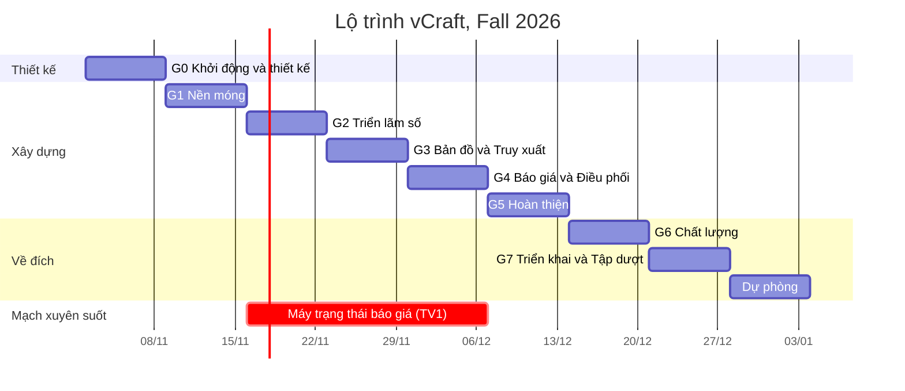

# vCraft: Lộ trình thực hiện từ đầu đến cuối

| | |
|---|---|
| Thời gian | 8 tuần, từ thứ Hai 02/11/2026 đến Chủ nhật 27/12/2026, sau đó là thời gian dự phòng tới ngày thi |
| Nhóm | 3 sinh viên (TV1, TV2, TV3) |
| Liên quan | [Mô tả sản phẩm](PRODUCT.md) · [PRD](PRD.md) · [README](../README.md) |

> Lịch này giả định buổi vấn đáp diễn ra từ cuối tháng 12/2026 trở đi. Nếu lịch thi của Trường sớm hơn: gộp Tuần 7 và Tuần 8, rồi cắt giảm theo [Phụ lục D](#phụ-lục-d-kế-hoạch-cắt-giảm-phạm-vi).

**Mục lục**

- [Phần A. Tổng quan](#phần-a-tổng-quan)
- [Phần B. Từng bước theo tuần](#phần-b-từng-bước-theo-tuần)
- [Phụ lục A. Checklist barem](#phụ-lục-a-checklist-barem)
- [Phụ lục B. Kịch bản demo 15 phút](#phụ-lục-b-kịch-bản-demo-15-phút)
- [Phụ lục C. Câu hỏi vấn đáp thường gặp](#phụ-lục-c-câu-hỏi-vấn-đáp-thường-gặp)
- [Phụ lục D. Kế hoạch cắt giảm phạm vi](#phụ-lục-d-kế-hoạch-cắt-giảm-phạm-vi)

---

## Phần A. Tổng quan

### A.1 Nguyên tắc
1. **Cắt dọc theo tính năng, không cắt ngang theo tầng.** Mỗi người sở hữu trọn một mảng nghiệp vụ, từ CSDL đến giao diện. Nhờ vậy khi vấn đáp ai cũng giải thích được một luồng từ đầu đến cuối.
2. **Cuối tuần nào cũng demo được.** Nhánh `main` luôn chạy được. Chủ nhật hằng tuần cả nhóm demo chéo cho nhau.
3. **P0 trước, P1 sau, P2 chỉ khi dư thời gian.** Mã yêu cầu (ví dụ `QUO-08`) lấy theo [PRD](PRD.md).
4. **Phần rủi ro cao làm sớm.** Máy trạng thái báo giá và pipeline ảnh bắt đầu từ Tuần 2 và Tuần 3, không để dồn về cuối.

### A.2 Phân vai

| Thành viên | Mảng sở hữu | Mã yêu cầu chính |
|---|---|---|
| **TV1**: Nền tảng & Báo giá | Repo, CI, CSDL, xác thực, phân quyền, máy trạng thái, yêu cầu báo giá, chào giá, chốt có khóa, tác vụ định kỳ, triển khai | AUTH, QUO, ORD-01, các SEC |
| **TV2**: Nghệ nhân & Truy xuất | Pipeline ảnh, hồ sơ xưởng, sản phẩm, lô và nhật ký, QR, trang truy xuất, phân bổ và tiến độ, thông báo | MED, WS, PRD, TRC, ORD-02 đến ORD-04, NTF |
| **TV3**: Trải nghiệm khách & Quản trị | Design system, bố cục trang, danh mục và tìm kiếm, trang chủ, bản đồ, đăng ký nghệ nhân, khu quản trị, tin tức, thống kê | CAT, MAP, ADM, NEWS, AUTH-02 phần giao diện, USA |

Mỗi người đều **review PR của ít nhất một người khác** mỗi tuần, để nắm code của nhau.

### A.3 Ma trận tuần

| Tuần | Giai đoạn | TV1 | TV2 | TV3 | Mốc |
|---|---|---|---|---|---|
| **1** · 02–08/11 | 0. Khởi động & thiết kế | ERD, API contract, repo, CI | Thực địa, mẫu công đoạn, wireframe màn nghệ nhân | Design system, wireframe màn công khai và quản trị | **M0** Thiết kế xong |
| **2** · 09–15/11 | 1. Nền móng | Khung API, Auth, RBAC, Session | Pipeline ảnh, `StorageProvider`, component upload | Khung SPA, router, layouts, UI kit, http client | **M1** Đăng nhập được 3 vai trò, upload ảnh ra 3 kích thước |
| **3** · 16–22/11 | 2. Triển lãm số | Máy trạng thái + test, model RFQ, thuật toán ghép | Hồ sơ xưởng, sản phẩm | Danh mục, chi tiết, trang chủ, đăng ký nghệ nhân, duyệt | **M2** Triển lãm số chạy được |
| **4** · 23–29/11 | 3. Bản đồ & Truy xuất | Biểu mẫu RFQ, gửi và mời, hộp cơ hội, chào giá | Lô, nhật ký, QR, trang truy xuất | Bản đồ, popup, bộ lọc, chọn vị trí, danh sách xưởng | **M3** Quét QR bằng điện thoại ra trang truy xuất |
| **5** · 30/11–06/12 | 4. Báo giá & Điều phối | So sánh, gợi ý phân bổ, chốt có khóa | Phân bổ, tiến độ, giao hàng, thông báo | Tin tức, bảng điều phối, thống kê | **M4** Luồng báo giá chạy trọn |
| **6** · 07–13/12 | 5. Hoàn thiện | Tác vụ hết hạn, SSE, trau chuốt UI báo giá | Trau chuốt trải nghiệm nghệ nhân trên điện thoại, in tem | Kiểm tra responsive, trạng thái rỗng và lỗi, seed đẹp | **M5** Đóng băng tính năng |
| **7** · 14–20/12 | 6. Chất lượng | Test backend, rà soát bảo mật | Tối ưu ảnh và hiệu năng | Lighthouse, khả năng tiếp cận, test e2e | **M6** Bản ứng viên phát hành |
| **8** · 21–27/12 | 7. Về đích | Triển khai | Tem QR thật, kịch bản demo | Bộ câu hỏi vấn đáp | **M7** v1.0.0 và 3 lần tập dượt |
| 28/12 → ngày thi | Dự phòng | Chỉ sửa lỗi nghiêm trọng | | | |

### A.4 Nhịp làm việc hằng tuần

| Khi nào | Việc | Thời lượng |
|---|---|---|
| Thứ Hai | Lên kế hoạch tuần: kéo issue vào cột "Tuần này", chốt ai làm gì | 30 phút |
| Thứ Năm | Họp nhanh: mỗi người nói đang làm gì, vướng gì | 15 phút |
| Hằng ngày | Mở PR nhỏ (dưới 400 dòng), review trong vòng 24 giờ | |
| Chủ nhật | **Demo chéo**: mỗi người chạy luồng của **người khác**, ghi lỗi thành issue. Đánh dấu mốc tuần | 60 phút |

### A.5 Định nghĩa "Xong" cho mỗi tính năng
- [ ] Chạy được trên máy người khác sau `pnpm install && pnpm dev`.
- [ ] Kiểm tra dữ liệu ở cả frontend và backend bằng chung một schema. Thông báo lỗi bằng tiếng Việt.
- [ ] Có đủ ba trạng thái: đang tải (skeleton), rỗng (có lời mời hành động), lỗi (có nút thử lại).
- [ ] Đã kiểm tra ở cỡ màn hình 360 px và 1280 px.
- [ ] Thao tác dữ liệu không làm tải lại trang.
- [ ] Đã thử bằng tài khoản **sai vai trò** và **sai chủ sở hữu**: phải nhận 403 hoặc 404.
- [ ] Có dữ liệu seed minh họa.
- [ ] PR đã được review, CI xanh. Có TSDoc cho các hàm service mới.
- [ ] Nếu đổi API thì đã cập nhật [PRD, mục 9](PRD.md).

---

## Phần B. Từng bước theo tuần

> Mỗi bước có: **người phụ trách** · **đầu ra** · tiêu chí barem liên quan (B1 đến B9, theo thứ tự trong bảng barem).

### Tuần 1 (02–08/11) · Giai đoạn 0: Khởi động và thiết kế

**Mục tiêu:** cả nhóm hiểu chung một sản phẩm, và có đủ bản vẽ để khi code không phải đoán.

- [ ] **0.1 Họp khởi động.** *Cả nhóm.* Đọc đề và 3 tài liệu này. Chốt nghề (gốm Bát Tràng), phân vai, kênh liên lạc, lịch họp.
  → Đầu ra: bảng phân vai, điền tên và MSSV vào README.
- [ ] **0.2 Dựng bảng công việc.** *TV1.* Tạo repo GitHub và GitHub Projects. Mỗi yêu cầu P0 và P1 thành một issue, gắn nhãn `module`, `P0/P1/P2` và người phụ trách. Thêm mẫu PR.
  → Đầu ra: bảng có khoảng 90 issue.
- [ ] **0.3 Đi thực địa Bát Tràng.** *TV2 chủ trì, cả nhóm đi nếu được.* Xin phép chụp ảnh 5 đến 8 xưởng. Ghi lại câu chuyện gia đình, giờ mở cửa, **tọa độ thật**. Chụp đủ 8 công đoạn cho ít nhất 2 lô. Mua 1 đến 2 sản phẩm thật để dán tem QR khi demo.
  → Đầu ra: thư mục ảnh gốc cùng file ghi chú dùng cho seed. Nếu không đi được thì dùng ảnh có giấy phép mở và ghi nguồn. *(B3)*
- [ ] **0.4 Vẽ wireframe** trên Figma, cả bản điện thoại và máy tính. *TV3: màn công khai và quản trị. TV2: màn nghệ nhân. TV1: luồng báo giá.*
  Khoảng 18 màn: Trang chủ, Danh sách sản phẩm, Chi tiết sản phẩm, Gian trưng bày, Bản đồ, Trang truy xuất, Tin tức, Đăng nhập, Đăng ký nghệ nhân (3 bước), Bảng điều khiển nghệ nhân, Hồ sơ xưởng, Sửa sản phẩm, Nhật ký lô, Hộp cơ hội báo giá cùng biểu mẫu chào giá, Tạo RFQ (3 bước), So sánh và chốt, Theo dõi đơn, Hàng đợi duyệt, Bảng điều phối. *(B2, B3)*
- [ ] **0.5 Design system.** *TV3.* Đưa các token màu, chữ, khoảng cách, bo góc từ [PRODUCT, mục 9](PRODUCT.md) vào Figma. Vẽ logo chữ v và con dấu. Thiết kế khoảng 10 component cơ bản.
  → Đầu ra: trang "UI Kit" trên Figma. *(B3)*
- [ ] **0.6 ERD và `schema.prisma` bản nháp.** *TV1*, cả nhóm review. Bám theo [PRD, mục 8](PRD.md). *(B9)*
- [ ] **0.7 Chốt API contract.** *TV1*, mọi người góp ý. Dùng bảng endpoint và ví dụ JSON ở [PRD, mục 9](PRD.md). Chốt bản v1. Từ đây đổi API phải báo cả nhóm. *(B4)*
- [ ] **0.8 Quy ước code.** *TV1.* ESLint, Prettier, Husky cùng lint-staged, Conventional Commits, cấu trúc thư mục theo README. *(B5)*

**🏁 M0, Chủ nhật 08/11:** có wireframe đủ các màn P0, UI Kit, ERD, API contract v1, bảng công việc. Cả nhóm cùng xem lại và chốt.

---

### Tuần 2 (09–15/11) · Giai đoạn 1: Nền móng

**Mục tiêu:** bộ khung để cả 3 người cùng code song song mà không giẫm chân nhau.

- [ ] **1.1 Dựng monorepo.** *TV1.* pnpm workspaces gồm `apps/web` (Vite, React, TS), `apps/api` (Express, TS), `packages/shared`. TypeScript `strict`, alias đường dẫn, `pnpm dev` chạy song song cả hai app. CI trên GitHub Actions chạy lint, typecheck, test, build. *(B5)*
- [ ] **1.2 CSDL.** *TV1.* Viết `docker-compose.yml` cho Postgres. Hoàn thiện `schema.prisma`, tạo migration đầu tiên. Seed khung: 3 vai trò, danh mục, mẫu công đoạn gốm, bảng `Counter`. *(B9)*
- [ ] **1.3 Khung API.** *TV1.* `app.ts`; kiểm tra biến môi trường bằng Zod; logger pino có `requestId`; các lớp lỗi kế thừa `AppError` và một error handler chung; định dạng phản hồi `{data}` / `{error}`; middleware `validate(schema)`; `helmet`, `cors`, `compression`. *(B4, B5, B7)*
- [ ] **1.4 Xác thực.** *TV1.* Đăng ký, đăng nhập, refresh xoay vòng, đăng xuất, `me`, `check-email`. bcrypt. Bảng `Session`. Middleware `requireAuth` và `requireRole`. Giới hạn tần suất đăng nhập. Test tích hợp bằng Supertest. *(B7)* · AUTH-01, AUTH-03
- [ ] **1.5 Pipeline ảnh.** *TV2.* `POST /media`: multer đọc vào bộ nhớ → kiểm tra magic bytes → sharp sinh 3 biến thể WebP và LQIP → `LocalStorage` → bản ghi `MediaAsset`. Phục vụ `/media` với header cache. Thử với ảnh 8 MB chụp từ điện thoại.
  → Đầu ra: ảnh 8 MB thành bản `thumb` khoảng 20 KB. *(B1, B4)* · MED-02 đến MED-04
- [ ] **1.6 Component `ImageUploader`.** *TV2.* Kéo thả, xem trước, thanh tiến trình cho từng ảnh (dùng `XMLHttpRequest` vì `fetch` không báo được tiến trình upload), sắp xếp bằng dnd-kit, xóa, báo lỗi từng ảnh. · MED-01
- [ ] **1.7 Khung SPA.** *TV3.* Router với 3 layout (Public, Artisan, Admin), route tải lười, `RequireRole`, trang 404 và 403. http client bọc `fetch`: tự gọi refresh khi gặp 401 (chỉ một lần, các yêu cầu khác xếp hàng chờ). `AuthProvider`. `QueryClient`. *(B4, B8)*
- [ ] **1.8 UI Kit bằng code.** *TV3.* Button, Input, Textarea, Select, Checkbox, DatePicker, `MoneyInput`, Dialog, `ConfirmDialog`, Toast, Card, Badge, Skeleton, `EmptyState`, Pagination, Tabs, `Stepper`, Breadcrumb, Lightbox. Header và Footer theo thương hiệu. Nạp font, khai báo token CSS. *(B3, B6)*
- [ ] **1.9 Trang đăng nhập và đăng ký khách hàng.** *TV3*, gọi API thật. Kiểm tra email bất đồng bộ, báo lỗi ngay khi nhập. *(B6)*

**🏁 M1, Chủ nhật 15/11:** đăng nhập được bằng cả 3 vai trò, mỗi vai trò vào đúng layout. Upload nhiều ảnh ra 3 kích thước. CI xanh.

---

### Tuần 3 (16–22/11) · Giai đoạn 2: Triển lãm số

**Mục tiêu:** khách xem được sản phẩm theo hộ và theo phân loại. Nghệ nhân đăng ký, được duyệt, rồi đăng sản phẩm.

- [ ] **2.1 Đăng ký nghệ nhân 3 bước.** *TV3 làm giao diện, TV1 làm `POST /auth/register-artisan`.* Bước 2 dùng bản đồ chọn vị trí (bản đơn giản, Tuần 4 nâng cấp). Bước 3 upload minh chứng ở chế độ riêng tư. Số CCCD mã hóa AES-GCM. · AUTH-02, SEC-09
- [ ] **2.2 Hàng đợi duyệt.** *TV3.* Danh sách hồ sơ chờ duyệt, trang chi tiết có trình xem minh chứng và số CCCD đã che. Duyệt hoặc từ chối kèm lý do. Ghi `AuditLog`. Khóa và mở khóa tài khoản. · ADM-01, ADM-02, ADM-05
- [ ] **2.3 Hồ sơ xưởng.** *TV2.* API và màn sửa: câu chuyện bằng TipTap (làm sạch ở server), thư viện ảnh, chứng nhận, trình chỉnh giờ mở cửa theo tuần, danh mục sở trường, năng lực. Slug tự sinh cùng `SlugHistory`. · WS-01 đến WS-03
- [ ] **2.4 Sản phẩm.** *TV2.* Thêm, sửa, xóa. `MoneyInput`. Tối đa 12 ảnh. Trạng thái. Cột `searchText` chuẩn hóa không dấu được ghi tự động mỗi khi lưu. · PRD-01, PRD-02, PRD-04
- [ ] **2.5 Trang công khai.** *TV3.* `/san-pham` có lọc, sắp xếp, cuộn vô hạn, bộ lọc đồng bộ với URL. `/san-pham/:slug`. `/danh-muc/:slug`. `/xuong`. `/xuong/:slug`. Trang chủ gồm ảnh lớn, sản phẩm nổi bật, xưởng tiêu biểu, bản tin. Mọi ảnh dùng `srcset` và LQIP. *(B1, B3, B4, B8)* · CAT-01 đến CAT-03, CAT-05, WS-04, WS-05
- [ ] **2.6 Tìm kiếm không dấu và gợi ý.** *TV3.* `GET /search/suggest`, debounce 300 ms, điều hướng bằng bàn phím. *(B6)* · CAT-04
- [ ] **2.7 Lõi báo giá.** *TV1.* Viết `QuoteStateMachine` cùng **unit test cho mọi cặp (trạng thái, sự kiện)**. Repository cho RFQ, Invitation, Bid, Order, Allocation. Service ghép hộ (mục 5.3 của PRD) cùng unit test. *(B1, B5)*

**🏁 M2, Chủ nhật 22/11:** đi trọn luồng "Đăng ký nghệ nhân → Admin duyệt → nghệ nhân điền hồ sơ và đăng 3 sản phẩm → khách vãng lai thấy sản phẩm, lọc theo hộ và theo phân loại". Test máy trạng thái xanh.

---

### Tuần 4 (23–29/11) · Giai đoạn 3: Bản đồ và Truy xuất

**Mục tiêu:** hoàn thành 2 yêu cầu kỹ thuật 4.1 và 4.3. Bắt đầu nửa đầu luồng báo giá.

- [ ] **3.1 Lô và nhật ký.** *TV2.* Tạo lô với mã sinh từ `Counter`. Thêm mốc: gợi ý công đoạn tiếp theo, bắt buộc có ảnh, kiểm tra thời gian. Sửa, xóa mốc khi lô chưa khóa. Hoàn tất lô: kiểm tra có mốc "Nung" và "Thành phẩm", rồi đặt `lockedAt`. Thêm ghi chú bổ sung. Gắn sản phẩm vào lô. · TRC-01 đến TRC-04, PRD-03
- [ ] **3.2 QR.** *TV2.* `GET /me/batches/:code/qr` trả PNG hoặc SVG, mức sửa lỗi H, có logo, có ETag. `GET /q/:code` trả 302 và tăng `scanCount`. Màn tải QR. · TRC-05, TRC-07, TRC-09
- [ ] **3.3 Trang truy xuất.** *TV2.* `/truy-xuat/:maLo` theo bố cục ở mục 5.5 của PRD. Ưu tiên điện thoại. Dòng thời gian hiện dần khi cuộn. Thẻ meta Open Graph. Hỗ trợ cả trạng thái "Đang thực hiện". *(B3)* · TRC-06, TRC-10
- [ ] **3.4 Bản đồ.** *TV3.* `GET /workshops/map` tính `isOpenNow` ở server theo giờ Việt Nam. Dùng react-leaflet, ghim màu theo trạng thái, popup, gom cụm, bộ lọc, danh sách bên cạnh đồng bộ với bản đồ, nút "Vị trí của tôi" và "Chỉ đường". · MAP-01 đến MAP-05
- [ ] **3.5 Chọn vị trí xưởng.** *TV3.* Kéo ghim thì gọi Nominatim để tự điền địa chỉ (có debounce và cache). Gõ địa chỉ thì ghim nhảy tới. Dùng ở bước 2 đăng ký và ở màn hồ sơ xưởng. *(B6)* · WS-06
- [ ] **3.6 Tạo và gửi RFQ.** *TV1.* Biểu mẫu 3 bước, tự lưu nháp. `send` thì chạy ghép hộ, tạo lời mời, ghi bản ghi thông báo. Trang "Yêu cầu của tôi". · QUO-01, QUO-02, QUO-09
- [ ] **3.7 Hộp cơ hội báo giá và chào giá.** *TV1.* Danh sách lời mời kèm lý do được mời. Biểu mẫu chào giá tự tính thành tiền và cảnh báo trễ hạn. Sửa chào giá theo `version` cùng `BidRevision`. Rút chào giá. Ràng buộc mỗi xưởng một chào giá. · QUO-03 đến QUO-05

**🏁 M3, Chủ nhật 29/11:** **quét QR bằng điện thoại thật** (qua IP LAN hoặc tunnel) ra trang truy xuất. Bản đồ hiển thị đúng xưởng đang mở và đang đóng. Khách gửi được RFQ, 2 nghệ nhân chào giá được.

---

### Tuần 5 (30/11–06/12) · Giai đoạn 4: Báo giá và Điều phối

**Mục tiêu:** hoàn thành yêu cầu kỹ thuật 4.2. Đây là phần khó nhất và nhiều điểm nhất.

- [ ] **4.1 So sánh và gợi ý phân bổ.** *TV1.* Bảng so sánh sắp xếp được. `GET /quotes/:code/allocation-suggestion` theo mục 5.4 của PRD. Giao diện chia số lượng, hiển thị tổng và báo thiếu hoặc thừa ngay khi nhập. Hộp thoại xác nhận. · QUO-06, QUO-07
- [ ] **4.2 Chốt có khóa.** *TV1.* Toàn bộ trong một transaction: kiểm tra `quoteVersion` và từng `bidVersion`, chuyển trạng thái T3, tạo đơn và phân bổ, chuyển các chào giá còn lại sang `REJECTED`, ghi lịch sử. Frontend xử lý `409`: tự tải lại và báo rõ điều gì đã thay đổi. **Test đồng thời**: `Promise.all` 2 yêu cầu chốt thì đúng 1 thành công. *(B1)* · QUO-08, QUO-11, ORD-01
- [ ] **4.3 Phân bổ và tiến độ.** *TV2.* Nghệ nhân bấm bắt đầu (kích hoạt T4), cập nhật tiến độ, gắn lô, đánh dấu đã giao. Khách xác nhận đã nhận (kích hoạt T5). Dòng thời gian trạng thái trên trang đơn của cả hai phía. · ORD-02 đến ORD-04, TRC-10 phần gắn với đơn
- [ ] **4.4 Thông báo.** *TV2.* `DomainEvents` dựa trên EventEmitter, `NotificationService`, API danh sách và đánh dấu đã đọc. Chuông thông báo tự hỏi lại server mỗi 30 giây. Trang `/thong-bao`. *(B4)* · NTF-01
- [ ] **4.5 Tin tức.** *TV3.* Khu quản trị thêm, sửa tin bằng TipTap (làm sạch ở server), chuyên mục, ghim, hẹn giờ. Trang `/tin-tuc`. Banner tin ghim trên trang chủ và bảng điều khiển nghệ nhân. · NEWS-01 đến NEWS-03
- [ ] **4.6 Bảng điều phối.** *TV3.* Liệt kê mọi RFQ, lọc theo trạng thái, xem chào giá và phân bổ, mời thêm hộ, cảnh báo sắp trễ. · ORD-05, ADM-06
- [ ] **4.7 Bảng thống kê.** *TV3.* Các thẻ số liệu và biểu đồ: RFQ theo trạng thái, sản phẩm theo danh mục, lượt quét QR 30 ngày. · ADM-04

**🏁 M4, Chủ nhật 06/12:** dùng 3 cửa sổ trình duyệt (khách sỉ, 2 nghệ nhân, admin) chạy trọn `DRAFT → SENT → BIDDING → ACCEPTED (chia 2 hộ) → IN_PRODUCTION → DELIVERED`. Thử mở 2 tab cùng bấm chốt thì có đúng một tab nhận 409.

---

### Tuần 6 (07–13/12) · Giai đoạn 5: Hoàn thiện

**Mục tiêu:** từ "chạy được" thành "đẹp và mượt". Cuối tuần **đóng băng tính năng**.

- [ ] **5.1 Tác vụ định kỳ.** *TV1.* node-cron: tự `EXPIRED`, nhắc trước hạn 24 giờ. Chạy lại nhiều lần không gây sai lệch. Có test. · QUO-10
- [ ] **5.2 Thông báo theo thời gian thực.** *TV1.* SSE tại `/notifications/stream`, quay về hỏi định kỳ khi mất kết nối. · NTF-02
- [ ] **5.3 Trải nghiệm nghệ nhân trên điện thoại.** *TV2.* Thêm mốc ngay từ camera (`accept="image/*" capture="environment"`), nút lớn, bảng điều khiển gồm cơ hội mới, lô đang làm, đơn đang chạy. Trang in tem A4. · TRC-08, MED-07
- [ ] **5.4 Kiểm tra responsive toàn bộ.** *TV3.* Mọi màn ở 360, 768, 1024, 1440 px. Đủ ba trạng thái tải, rỗng, lỗi. Trang 404 và 403. Toast. Hộp thoại xác nhận. Viết lại câu chữ theo [PRODUCT, mục 9.8](PRODUCT.md). *(B2, B3)*
- [ ] **5.5 Seed đẹp.** *Cả nhóm.* 15 xưởng có ảnh thật và tọa độ thật. 120 sản phẩm. 20 lô có nhật ký đầy đủ. 6 RFQ, mỗi cái ở một trạng thái khác nhau, trong đó `RFQ26-0001` "5.000 cốc in logo UET" đang `BIDDING` với 4 chào giá để dùng khi demo. 12 tin tức. 1 hồ sơ chờ duyệt. Chạy seed nhiều lần vẫn ra cùng kết quả.
- [ ] **5.6 Rà soát chéo.** *Cả nhóm.* Mỗi người chạy kịch bản demo ở Phụ lục B trên phần của người khác và ghi lỗi.

**🏁 M5, Chủ nhật 13/12: ĐÓNG BĂNG TÍNH NĂNG.** Sau mốc này chỉ sửa lỗi, tối ưu và viết tài liệu. Yêu cầu P1 nào chưa xong thì chuyển sang P2.

---

### Tuần 7 (14–20/12) · Giai đoạn 6: Chất lượng

**Mục tiêu:** đạt các chỉ tiêu phi chức năng ở mục 6 của PRD.

- [ ] **6.1 Hiệu năng.** *TV2.* Kiểm tra dung lượng ảnh thật trên trang danh sách (mục tiêu ≤ 1 MB), `sizes` đặt đúng, lazy load, không bị giật bố cục. Phân tích gói JS bằng `rollup-plugin-visualizer`, tải lười Leaflet, TipTap và khu quản trị. Bật log truy vấn của Prisma để tìm lỗi N+1. Thêm index. Chạy Lighthouse cho 3 trang. *(B4)* · PERF-01 đến PERF-06
- [ ] **6.2 Bảo mật.** *TV1.* Rà checklist SEC-01 đến SEC-12. Thử tấn công: IDOR (sửa sản phẩm của xưởng khác), XSS (chèn `<script>` vào tin tức và mô tả), file giả ảnh (`.exe` đổi đuôi thành `.jpg`), dò mật khẩu, CSRF. Chạy `pnpm audit`. *(B7)*
- [ ] **6.3 Kiểm thử.** *TV1, TV2: unit và tích hợp. TV3: e2e.* Unit: máy trạng thái, ghép hộ, phân bổ, slug, `isOpenNow`, chuẩn hóa tìm kiếm. Tích hợp: auth, chốt đồng thời, khóa lô, phân quyền. E2E bằng Playwright: (a) khách xem, lọc, quét truy xuất; (b) luồng báo giá trọn vẹn; (c) đăng ký, duyệt. Đưa tất cả vào CI. · MAINT-01
- [ ] **6.4 Khả năng tiếp cận.** *TV3.* Chạy axe DevTools, kiểm tra độ tương phản, `alt`, `label`, thứ tự focus, dùng bàn phím trên popup bản đồ và lightbox. · USA-02
- [ ] **6.5 Dọn code.** *Cả nhóm.* Review chéo toàn bộ, xóa code chết, viết TSDoc cho service, cập nhật README và PRD cho khớp code thật. *(B5)*
- [ ] **6.6 Thử độc lập CSDL.** *TV1.* Đổi `provider` sang `mysql`, chạy `prisma db push`, chạy seed, đi một vòng luồng chính. Ghi kết quả vào README. *(B9)*

**🏁 M6, Chủ nhật 20/12:** gắn tag `v1.0.0-rc.1`. Lighthouse đạt chỉ tiêu. Toàn bộ test xanh. Không còn lỗi mức nghiêm trọng.

---

### Tuần 8 (21–27/12) · Giai đoạn 7: Triển khai và Tập dượt

**Mục tiêu:** sẵn sàng cho buổi vấn đáp mà không có bất ngờ.

- [ ] **7.1 Triển khai.** *TV1.* Lựa chọn 1: VPS với Docker Compose, Nginx và chứng chỉ HTTPS của Let's Encrypt. Lựa chọn 2: Render (API và Postgres) cùng Vercel hoặc Netlify (web, cấu hình rewrite cho SPA). Gắn tên miền. Đặt `APP_URL` đúng. Seed dữ liệu trên production.
- [ ] **7.2 Tem QR thật.** *TV2.* In tem cho 1 đến 2 lô, dán lên sản phẩm gốm thật đã mua ở Tuần 1. Thử quét bằng cả iPhone và Android, cả qua wifi và 4G.
- [ ] **7.3 Tập dượt.** *Cả nhóm.* Chạy [kịch bản demo](#phụ-lục-b-kịch-bản-demo-15-phút) **ít nhất 3 lần có bấm giờ**, luân phiên người thao tác để ai cũng demo được mọi phần.
- [ ] **7.4 Vấn đáp thử.** *Cả nhóm.* Hỏi đáp chéo theo [Phụ lục C](#phụ-lục-c-câu-hỏi-vấn-đáp-thường-gặp). Mỗi người phải trả lời được **mọi** câu, không chỉ câu thuộc phần mình.
- [ ] **7.5 Đóng băng.** Gắn tag `v1.0.0`. Xuất bản sao lưu CSDL. Quay video màn hình dự phòng (chỉ dùng khi có sự cố mạng hoặc thiết bị, vì đề bài yêu cầu demo trực tiếp).

**🏁 M7, Chủ nhật 27/12:** bản v1.0.0 đã triển khai, đã tập dượt 3 lần, checklist barem ở Phụ lục A tick đủ.

### Ngày thi: checklist trước giờ vào phòng
- [ ] Chạy `pnpm db:reset` trên production (hoặc khôi phục bản sao lưu) **trước 1 giờ**.
- [ ] Mở sẵn 3 profile Chrome đã đăng nhập: **Khách sỉ**, **Nghệ nhân**, **Admin**. Zoom 110%. Tắt thông báo của hệ điều hành.
- [ ] Điện thoại đã sạc đầy, bật 4G phát wifi. Sản phẩm có tem QR. Có sẵn bản chạy local bằng Docker phòng khi mất mạng.
- [ ] Mở sẵn VS Code ở thư mục `apps/api/src/modules/quotes` và file `schema.prisma`.
