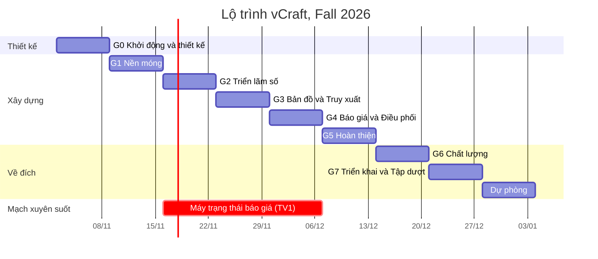

# vCraft: Lộ trình thực hiện từ đầu đến cuối

| | |
|---|---|
| Thời gian | 8 tuần, từ thứ Hai 02/11/2026 đến Chủ nhật 27/12/2026, sau đó là thời gian dự phòng tới ngày thi |
| Nhóm | 3 sinh viên (TV1, TV2, TV3) |
| Liên quan | [Mô tả sản phẩm](PRODUCT.md) · [PRD](PRD.md) · [README](../README.md) |

> Lịch này giả định buổi vấn đáp diễn ra từ cuối tháng 12/2026 trở đi. Nếu lịch thi của Trường sớm hơn: gộp Tuần 7 và Tuần 8, rồi cắt giảm theo [Phụ lục D](#phụ-lục-d-kế-hoạch-cắt-giảm-phạm-vi).

**Mục lục**

- [Phần A. Tổng quan](#phần-a-tổng-quan)
- [Phần B. Từng bước theo tuần](#phần-b-từng-bước-theo-tuần)
- [Phụ lục A. Checklist barem](#phụ-lục-a-checklist-barem)
- [Phụ lục B. Kịch bản demo 15 phút](#phụ-lục-b-kịch-bản-demo-15-phút)
- [Phụ lục C. Câu hỏi vấn đáp thường gặp](#phụ-lục-c-câu-hỏi-vấn-đáp-thường-gặp)
- [Phụ lục D. Kế hoạch cắt giảm phạm vi](#phụ-lục-d-kế-hoạch-cắt-giảm-phạm-vi)

---

## Phần A. Tổng quan

### A.1 Nguyên tắc
1. **Cắt dọc theo tính năng, không cắt ngang theo tầng.** Mỗi người sở hữu trọn một mảng nghiệp vụ, từ CSDL đến giao diện. Nhờ vậy khi vấn đáp ai cũng giải thích được một luồng từ đầu đến cuối.
2. **Cuối tuần nào cũng demo được.** Nhánh `main` luôn chạy được. Chủ nhật hằng tuần cả nhóm demo chéo cho nhau.
3. **P0 trước, P1 sau, P2 chỉ khi dư thời gian.** Mã yêu cầu (ví dụ `QUO-08`) lấy theo [PRD](PRD.md).
4. **Phần rủi ro cao làm sớm.** Máy trạng thái báo giá và pipeline ảnh bắt đầu từ Tuần 2 và Tuần 3, không để dồn về cuối.

### A.2 Phân vai

| Thành viên | Mảng sở hữu | Mã yêu cầu chính |
|---|---|---|
| **TV1**: Nền tảng & Báo giá | Repo, CI, CSDL, xác thực, phân quyền, máy trạng thái, yêu cầu báo giá, chào giá, chốt có khóa, tác vụ định kỳ, triển khai | AUTH, QUO, ORD-01, các SEC |
| **TV2**: Nghệ nhân & Truy xuất | Pipeline ảnh, hồ sơ xưởng, sản phẩm, lô và nhật ký, QR, trang truy xuất, phân bổ và tiến độ, thông báo | MED, WS, PRD, TRC, ORD-02 đến ORD-04, NTF |
| **TV3**: Trải nghiệm khách & Quản trị | Design system, bố cục trang, danh mục và tìm kiếm, trang chủ, bản đồ, đăng ký nghệ nhân, khu quản trị, tin tức, thống kê | CAT, MAP, ADM, NEWS, AUTH-02 phần giao diện, USA |

Mỗi người đều **review PR của ít nhất một người khác** mỗi tuần, để nắm code của nhau.

### A.3 Ma trận tuần

| Tuần | Giai đoạn | TV1 | TV2 | TV3 | Mốc |
|---|---|---|---|---|---|
| **1** · 02–08/11 | 0. Khởi động & thiết kế | ERD, API contract, repo, CI | Thực địa, mẫu công đoạn, wireframe màn nghệ nhân | Design system, wireframe màn công khai và quản trị | **M0** Thiết kế xong |
| **2** · 09–15/11 | 1. Nền móng | Khung API, Auth, RBAC, Session | Pipeline ảnh, `StorageProvider`, component upload | Khung SPA, router, layouts, UI kit, http client | **M1** Đăng nhập được 3 vai trò, upload ảnh ra 3 kích thước |
| **3** · 16–22/11 | 2. Triển lãm số | Máy trạng thái + test, model RFQ, thuật toán ghép | Hồ sơ xưởng, sản phẩm | Danh mục, chi tiết, trang chủ, đăng ký nghệ nhân, duyệt | **M2** Triển lãm số chạy được |
| **4** · 23–29/11 | 3. Bản đồ & Truy xuất | Biểu mẫu RFQ, gửi và mời, hộp cơ hội, chào giá | Lô, nhật ký, QR, trang truy xuất | Bản đồ, popup, bộ lọc, chọn vị trí, danh sách xưởng | **M3** Quét QR bằng điện thoại ra trang truy xuất |
| **5** · 30/11–06/12 | 4. Báo giá & Điều phối | So sánh, gợi ý phân bổ, chốt có khóa | Phân bổ, tiến độ, giao hàng, thông báo | Tin tức, bảng điều phối, thống kê | **M4** Luồng báo giá chạy trọn |
| **6** · 07–13/12 | 5. Hoàn thiện | Tác vụ hết hạn, SSE, trau chuốt UI báo giá | Trau chuốt trải nghiệm nghệ nhân trên điện thoại, in tem | Kiểm tra responsive, trạng thái rỗng và lỗi, seed đẹp | **M5** Đóng băng tính năng |
| **7** · 14–20/12 | 6. Chất lượng | Test backend, rà soát bảo mật | Tối ưu ảnh và hiệu năng | Lighthouse, khả năng tiếp cận, test e2e | **M6** Bản ứng viên phát hành |
| **8** · 21–27/12 | 7. Về đích | Triển khai | Tem QR thật, kịch bản demo | Bộ câu hỏi vấn đáp | **M7** v1.0.0 và 3 lần tập dượt |
| 28/12 → ngày thi | Dự phòng | Chỉ sửa lỗi nghiêm trọng | | | |

### A.4 Nhịp làm việc hằng tuần

| Khi nào | Việc | Thời lượng |
|---|---|---|
| Thứ Hai | Lên kế hoạch tuần: kéo issue vào cột "Tuần này", chốt ai làm gì | 30 phút |
| Thứ Năm | Họp nhanh: mỗi người nói đang làm gì, vướng gì | 15 phút |
| Hằng ngày | Mở PR nhỏ (dưới 400 dòng), review trong vòng 24 giờ | |
| Chủ nhật | **Demo chéo**: mỗi người chạy luồng của **người khác**, ghi lỗi thành issue. Đánh dấu mốc tuần | 60 phút |

### A.5 Định nghĩa "Xong" cho mỗi tính năng
- [ ] Chạy được trên máy người khác sau `pnpm install && pnpm dev`.
- [ ] Kiểm tra dữ liệu ở cả frontend và backend bằng chung một schema. Thông báo lỗi bằng tiếng Việt.
- [ ] Có đủ ba trạng thái: đang tải (skeleton), rỗng (có lời mời hành động), lỗi (có nút thử lại).
- [ ] Đã kiểm tra ở cỡ màn hình 360 px và 1280 px.
- [ ] Thao tác dữ liệu không làm tải lại trang.
- [ ] Đã thử bằng tài khoản **sai vai trò** và **sai chủ sở hữu**: phải nhận 403 hoặc 404.
- [ ] Có dữ liệu seed minh họa.
- [ ] PR đã được review, CI xanh. Có TSDoc cho các hàm service mới.
- [ ] Nếu đổi API thì đã cập nhật [PRD, mục 9](PRD.md).
